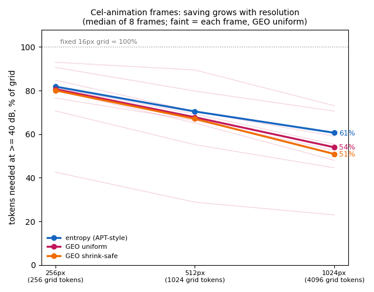

# GEO quadtrees as vision-model tokens: first measurements

Measured 2026-11-22. CPU only: no model was run and nothing was trained. This page measures the **token** side of the
open hypothesis in the README. It does not measure task accuracy.



## Headline

- **A GEO quadtree tokenizer needs about half the tokens of a standard 16px grid on 1024px cel-animation frames**
  at the same fidelity (51% of the grid at ≥40 dB, median of 8 frames).
- **The saving grows with resolution.** Every frame needs a smaller share at every doubling: 81% → 68% → 51% of the grid at 256 → 512 → 1024.
- **GEO beats a published-style entropy rule, and the lead grows with size:** 1 point at 256, 3 at 512, 10 at 1024.
  At 1024 GEO uses 16% fewer tokens (2084 against 2484).
- **A GEO-specific rule, "shrink-safe", is decisive on blocky content:** 8x pixel art goes from 589 tokens to 16, still lossless.
- **On cel frames the floor is the ink.** About 70% of tokens sit on outlines and edges. Grain, drawn texture and video
  compression cost nothing measurable.

## Prior work

The general idea is published and works:
- **Quadformer** (Ronen et al., CVPR-W 2023) builds a saliency-guided quadtree of mixed-size patches for a ViT.
- **APT** (2025; ICLR 2026) gives large patches to low-entropy regions and reports 40–50% faster ViT-L/H.
- **SPLIT and DART** (2025–26) learn where to split.

What is GEO's own here:
- the tolerance tree from the codec (`canPrune`, YCbCr);
- the **shrink-safe** rule read from that tree's progressive cut;
- the measurements on cel animation, which those papers (on ImageNet photos) do not cover.

## Method

- **What the model sees.** A ViT shrinks every token to 16x16. Each token is area-downsampled to 16x16 and blown back up.
  Fidelity = PSNR against the original (99 = lossless). "Tokens needed" = fewest tokens among the swept settings that reach the bar.
- **Tokenizers** (all square, power-of-two sizes, 16px floor):
  - **GEO uniform:** an exact mirror of `canPrune` in `go/pkg/quadtree/builder.go`. Bottom-up from pixels in YCbCr; merge
    when all 4 children are leaves within 255−q on Y and twice that on Cb/Cr. Token = a merged node ≥16px, or a 16px block.
  - **GEO shrink-safe:** the same tree. A node of size s is one token when every s/16 block inside it is a GEO leaf,
    i.e. the tree is fully merged 4 levels below it, so shrinking it to 16x16 keeps what GEO's tolerance keeps.
    Every uniform leaf is shrink-safe, so this rule never needs more tokens at the same q.
  - **Entropy (APT-style):** split a block while its 256-bin grey-level entropy is above a threshold. This follows APT's
    idea; it is not APT's code.
  - **Grid:** fixed patches.
- **Images:**
  - the 5 generated graphics from `benchmarks/make_test_images.py`, at 512;
  - 8 frames from a cel-animated episode in production, taken from lossless 1080p renders. These frames are not
    published, so those rows can't be reproduced from this repo.

## Results

**Generated graphics, 512px, tokens needed at ≥40 dB (grid = 1024):**

| image | GEO uniform | GEO shrink-safe | entropy | best grid |
|---|---|---|---|---|
| pixelart (8x) | 589 | **16** | 109 | 16 |
| lineart_sparse (~1% ink) | **184** | **184** | 190 | 1024 |
| illustration_flat | 307 | **295** | 358 | 1024 |
| ui_screenshot | 673 | **664** | 715 | 1024 |
| lineart_cel (~11% ink) | **664** | **664** | 685 | 1024 |

**Cel-animation frames, the same picture at three sizes, median of 8 at ≥40 dB:**

| size | grid | GEO uniform | GEO shrink-safe | entropy |
|---|---|---|---|---|
| 256 | 256 | 206 (81%) | 205 (80%) | 210 (82%) |
| 512 | 1024 | 694 (68%) | 686 (67%) | 721 (70%) |
| 1024 | 4096 | 2210 (54%) | **2084 (51%)** | 2484 (61%) |


**Where tokens go on cel frames (512, GEO uniform, ≥40 dB):**
- about 70% contain ink or edge pixels;
- about 18% are smooth shading that still splits;
- about 8% are merged big tokens;
- about 4% are texture.

Three checks changed nothing:
- lossless renders against the H.264 release: 688 → 688 tokens;
- smoothing away the drawn texture with edge-preserving mean-shift: 688 → 687 tokens;
- either way, outlines set the floor.

## What this does not show

- **No task accuracy.** PSNR of what the model sees is a proxy. The next step is to feed GEO and shrink-safe tokens
  into Quadformer's public model and compare accuracy at equal token counts.
- **One episode, 8 frames, no photographs** in the resolution test.
- **Nothing above 1024.** The masters are 1080p, and upscaling would be fake data. The trend suggests the saving keeps
  growing; that is not measured.
- **The sweeps are coarse** (11 settings), so "tokens needed" is close to the optimum, not exact.
- **Absolute token count still rises with resolution.** GEO changes how steeply it rises.

## Reproduce

```
cd benchmarks && python make_test_images.py           # the 5 generated graphics
cd vision_tokens && python geotok.py <folder of square power-of-two PNGs> results_mine.json
```

`results.json` holds the full sweeps for the generated graphics and the per-size summaries for the cel frames
(frame names anonymised).
