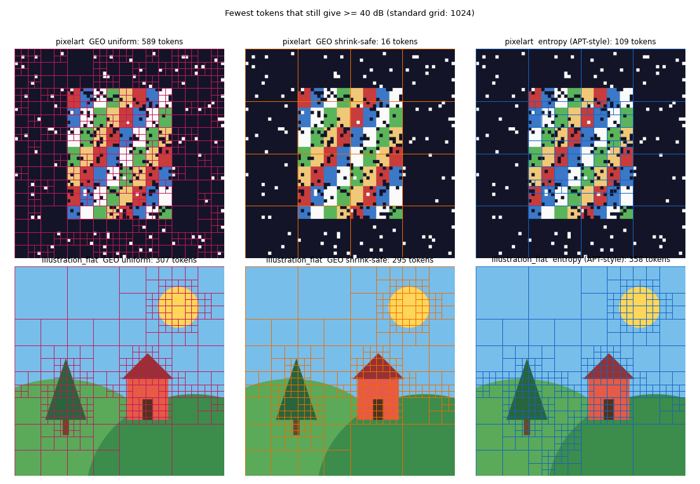
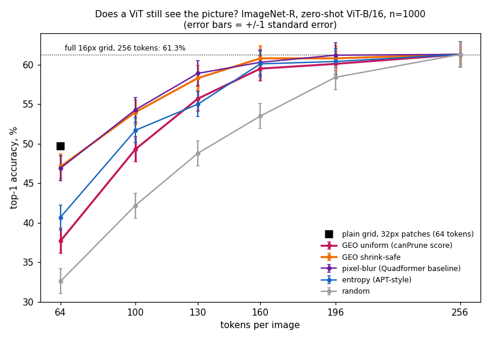
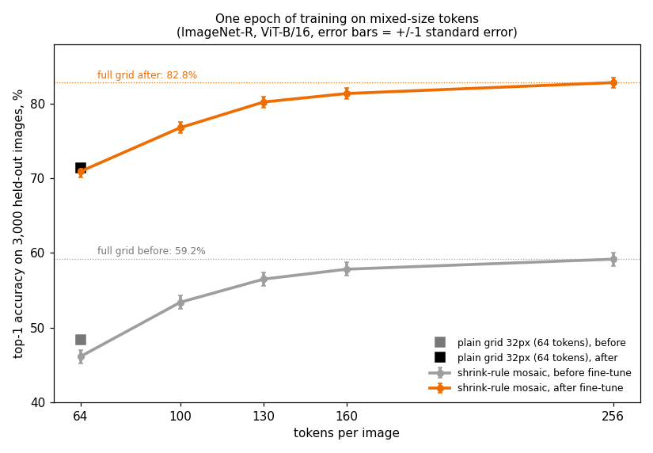

# GEO quadtrees as vision-model tokens: first measurements

Measured 2026-11-22. The token counts are CPU-only. One zero-shot accuracy pilot was run on a public ViT (see
"Accuracy pilot"); nothing was trained. This page records measurements, not a claim that GEO is better than
other methods.


## Headline

- **On 1024px cel-animation frames, a quadtree cut from the GEO tree needed 51% of a standard 16px grid's tokens**
  at the same fidelity (≥40 dB, median of 8 frames).
- **The share falls as resolution rises:** 81% → 67% → 51% at 256 → 512 → 1024, on every frame. This is the known
  behaviour of region quadtrees (cost follows boundary length, not area), measured here on cel animation.
- **Rules differ by a few points:** at 1024 the shrink rule needed 2084 tokens and an entropy rule 2484. On a real
  model (accuracy pilot) the ranking is different, so token counts alone don't rank the rules.
- **The shrink rule finds the right patch size on blocky content:** 8x pixel art goes from 589 tokens to 16, still
  lossless. The idea is not new: it is Quadformer's published pixel-blur baseline, applied as a threshold on the GEO tree.
- **On cel frames the floor is the ink.** About 70% of tokens sit on outlines and edges. Grain, drawn texture and video
  compression cost nothing measurable.

## Prior work

The general idea is published and works:
- **Quadformer** (Ronen et al., CVPR-W 2023) builds a saliency-guided quadtree of mixed-size patches for a ViT.
- **APT** (2025; ICLR 2026) gives large patches to low-entropy regions and reports 40–50% faster ViT-L/H.
- **SPLIT and DART** (2025–26) learn where to split.

Quadformer's public code (tokenizers only; trained models were never released) also includes:
- a **PixelBlurPatchScorer**, which scores a patch by the error of shrinking it to 16x16 and blowing it back up. That is
  the same question as the shrink-safe rule below. It was their baseline; their learned feature-based scorer beat it.
- a **Z-curve (Morton) quadtree** implementation.

What is GEO's own here is narrower:
- one tolerance tree that serves both the codec (`canPrune`, YCbCr) and the tokenizer, with thresholds instead of a
  fixed token budget;
- the measurements on cel animation and the resolution trend, which those papers (on ImageNet photos) do not cover.

*Corrected 2026-11-22: an earlier version listed the shrink-safe rule as GEO's own.*

## Method

- **What the model sees.** A ViT shrinks every token to 16x16. Each token is area-downsampled to 16x16 and blown back up.
  Fidelity = PSNR against the original (99 = lossless). "Tokens needed" = fewest tokens among the swept settings that reach the bar.
- **Tokenizers** (all square, power-of-two sizes, 16px floor):
  - **GEO uniform:** an exact mirror of `canPrune` in `go/pkg/quadtree/builder.go`. Bottom-up from pixels in YCbCr; merge
    when all 4 children are leaves within 255−q on Y and twice that on Cb/Cr. Token = a merged node ≥16px, or a 16px block.
  - **GEO shrink-safe:** the same tree. A node of size s is one token when every s/16 block inside it is a GEO leaf,
    i.e. the tree is fully merged 4 levels below it, so shrinking it to 16x16 keeps what GEO's tolerance keeps.
    Every uniform leaf is shrink-safe, so this rule never needs more tokens at the same q.
  - **Entropy (APT-style):** split a block while its 256-bin grey-level entropy is above a threshold. This follows APT's
    idea; it is not APT's code.
  - **Grid:** fixed patches.
- **Images:**
  - the 5 generated graphics from `benchmarks/make_test_images.py`, at 512;
  - 8 frames from a cel-animated episode in production, taken from lossless 1080p renders. These frames are not
    published, so those rows can't be reproduced from this repo.

## Results

**Generated graphics, 512px, tokens needed at ≥40 dB (grid = 1024):**

| image | GEO uniform | GEO shrink-safe | entropy | best grid |
|---|---|---|---|---|
| pixelart (8x) | 589 | **16** | 109 | 16 |
| lineart_sparse (~1% ink) | **184** | **184** | 190 | 1024 |
| illustration_flat | 307 | **295** | 358 | 1024 |
| ui_screenshot | 673 | **664** | 715 | 1024 |
| lineart_cel (~11% ink) | **664** | **664** | 685 | 1024 |

**Cel-animation frames, the same picture at three sizes, median of 8 at ≥40 dB:**

| size | grid | GEO uniform | GEO shrink-safe | entropy |
|---|---|---|---|---|
| 256 | 256 | 206 (81%) | 205 (80%) | 210 (82%) |
| 512 | 1024 | 694 (68%) | 686 (67%) | 721 (70%) |
| 1024 | 4096 | 2210 (54%) | **2084 (51%)** | 2484 (61%) |



**Where tokens go on cel frames (512, GEO uniform, ≥40 dB):**
- about 70% contain ink or edge pixels;
- about 18% are smooth shading that still splits;
- about 8% are merged big tokens;
- about 4% are texture.

Three checks changed nothing:
- lossless renders against the H.264 release: 688 → 688 tokens;
- smoothing away the drawn texture with edge-preserving mean-shift: 688 → 687 tokens;
- either way, outlines set the floor.

## Accuracy pilot: zero-shot ViT-B/16 on ImageNet-R



**Setup.**
- **Model:** a public, pretrained ViT-B/16 (`vit_base_patch16_224.augreg2_in21k_ft_in1k`, run at 256px), with no training.
- **Data:** 1000 random ImageNet-R images (cartoons, sketches, art), top-1 over its 200 classes. The standard error is about ±1.6 points.
- **Budgets:** every tokenizer cuts each image to an exact token budget, splitting the worst patch first.
- **How tokens enter the model:** each token is shrunk to 16x16, run through the pretrained patch embedding, and placed
  at the mean of the grid positions it covers.
- **Check:** the full grid through this path reproduces the model's own output exactly.
- **Files:** notebook `benchmarks/vision_tokens/geo_tokens_pilot.ipynb`; numbers in `pilot_results.json`.

| tokens | 64 | 100 | 130 | 160 | 196 | 256 |
|---|---|---|---|---|---|---|
| GEO uniform (canPrune score) | 37.7 | 49.3 | 55.7 | 59.5 | 60.1 | 61.3 |
| GEO shrink-safe | **47.1** | 54.0 | 58.3 | **60.8** | 60.8 | 61.3 |
| pixel-blur (Quadformer baseline) | 46.9 | **54.3** | **58.9** | 60.3 | **61.2** | 61.3 |
| entropy (APT-style) | 40.7 | 51.7 | 55.0 | 60.1 | 60.4 | 61.3 |
| random | 32.6 | 42.2 | 48.8 | 53.5 | 58.4 | 61.3 |
| plain grid | **49.7** (32px) | | | | | 61.3 (16px) |

- **37% fewer tokens with no measurable loss, zero-shot:** the shrink rule keeps 60.8% at 160 tokens against 61.3% at 256.
- **The shrink question is the right one; the codec's "one colour" question is not.** GEO uniform is the weakest
  content-aware rule at low budgets. Shrink-safe and pixel-blur tie within noise, as expected for the same idea.
- **At 64 tokens a plain coarse grid keeps the most (49.7%).** A model never trained on mixed-size tokens prefers a uniformly
  coarser image. Published work closes this gap with a short fine-tune.

## Fine-tune: one epoch on mixed-size tokens



**Setup.**
- **Data:** ImageNet-R split per class: 20,912 images for training, 9,088 held out, 3,000 of those scored.
- **Training:** the same public ViT-B/16, one pass with a random token budget per batch (64–256, shrink rule).
  AdamW, learning rate 1e-5, batch 32, about 8 minutes on a free Kaggle T4.
- **Check:** the full-grid check passed again.
- **Files:** notebook `benchmarks/vision_tokens/geo_tokens_finetune.ipynb`; numbers in `finetune_results.json`.
  The standard error is about ±0.9 points.

| tokens | 64 | 100 | 130 | 160 | 256 (full) | plain grid, 64 (32px) |
|---|---|---|---|---|---|---|
| before | 46.1 | 53.4 | 56.5 | 57.8 | 59.2 | 48.4 |
| after | 70.9 | 76.8 | 80.2 | 81.4 | 82.8 | 71.4 |

- **The low-budget gap closes.** At 64 tokens the mosaic trailed the coarse grid by 2.2 points before training and
  by 0.5 after, which is within noise.
- **The mosaic keeps more of the full score after training:** 98% at 160 tokens, 97% at 130, 86% at 64 (78% before).
- **A mosaic can meet any budget; a grid cannot.** A grid comes only in 16, 64 or 256 tokens. At 130–160 tokens the
  mosaic keeps 97–98% of full accuracy with 40–50% fewer tokens.
- **Most of the overall rise (59% → 83%) is the model learning ImageNet-R's style,** not the tokens: the full grid
  rose by the same amount. The fair comparison is mosaic against grid on the same trained model.
- **Not shown:** a mosaic outscoring a coarse grid at the same token count. At 64 they tie.

## What this does not show

- **No cel-frame accuracy.** The accuracy results are on ImageNet-R (one zero-shot pilot, one single-epoch fine-tune); the cel-frame results are PSNR, a proxy. Quadformer's trained models were never released, so
  the next step is a zero-shot pilot: a standard public ViT-B/16 fed GEO, pixel-blur, entropy and random tokens at
  equal token budgets, scored on ImageNet-R.
- **One episode, 8 frames, no photographs** in the resolution test.
- **Nothing above 1024.** The masters are 1080p, and upscaling would be fake data. The trend suggests the saving keeps
  growing; that is not measured.
- **The sweeps are coarse** (11 settings), so "tokens needed" is close to the optimum, not exact.
- **Absolute token count still rises with resolution.** GEO changes how steeply it rises.

## Reproduce

```
cd benchmarks && python make_test_images.py           # the 5 generated graphics
cd vision_tokens && python geotok.py <folder of square power-of-two PNGs> results_mine.json
```

`results.json` holds the full sweeps for the generated graphics and the per-size summaries for the cel frames
(frame names anonymised).
